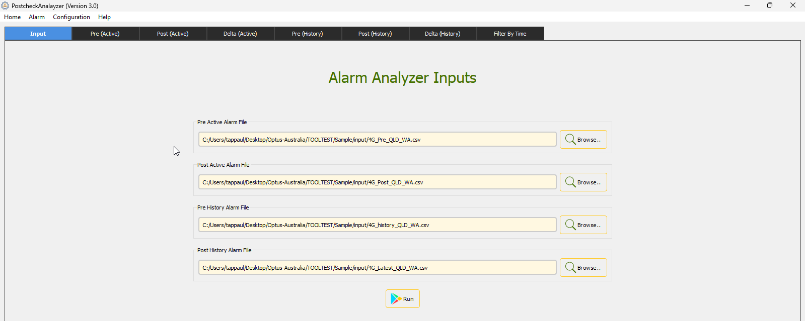
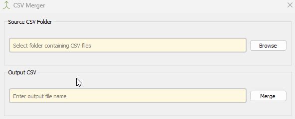
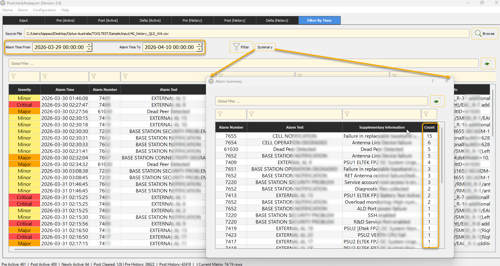

## PostCheck Analyzer

Desktop application for telecom alarm analysis and pre/post comparison.

**Technologies:** Python · PyQt5 · Pandas · SQLite

### 01. Post-Check Analyzer Overview

### 02. Alarm Analyzer Input

Input can be browsed individually or a folder containing pre,post,history alarms can be dragged and dropped to the input interface:

### 03. Configuration Analyzer Input

### 04. Alarm Merger Input

It merges multiple alarm files into a single file

### 05. Advanced Alarm Filtering

Global filter, Local filter, Multiple text filter, Inverse filter, Multiple inverse filter and Sorting

### 06. Time based filtering and Summary

Time based filter grabs the alarms from a predefined start and stop time:

[View Project](https://github.com/tapon788/PostCheck)

---
