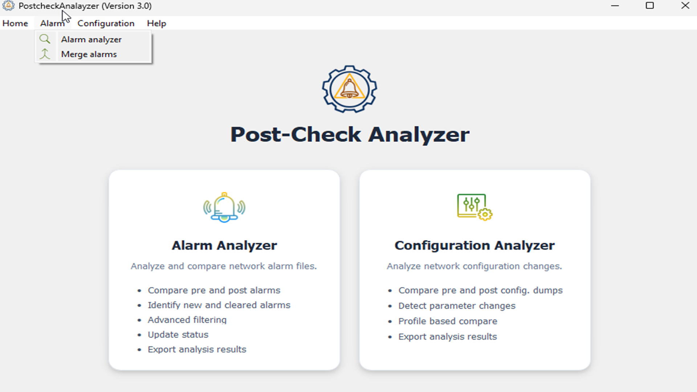
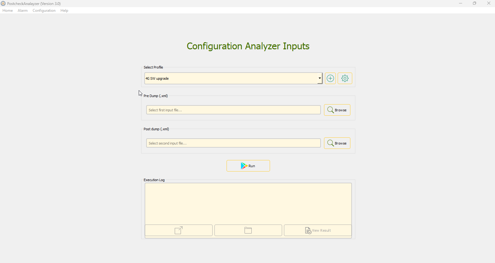
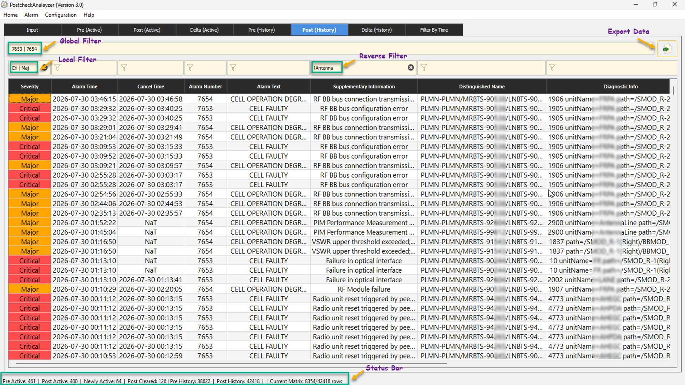

## PostCheck Analyzer

Desktop application for telecom alarm analysis and pre/post comparison.

**Technologies:** Python · PyQt5 · Pandas · SQLite

### 01. Post-Check Analyzer Overview

### 02. Alarm Analyzer Input

### 03. Configuration Analyzer Input

### 04. Alarm Merger Input

### 05. Advanced Alarm Filtering

### 06. Time based filtering and Summary

[View Project](https://github.com/tapon788/PostCheck)

---
